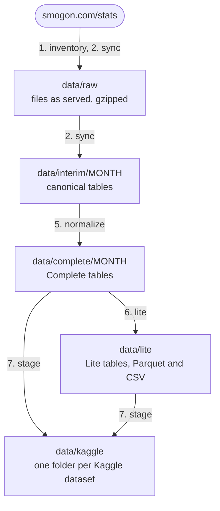
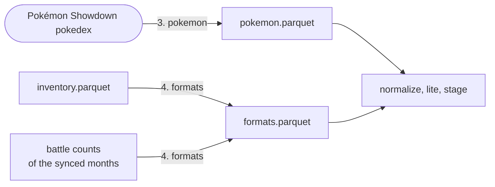
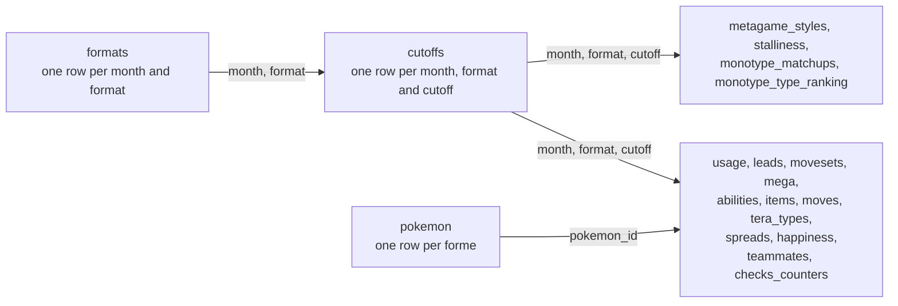
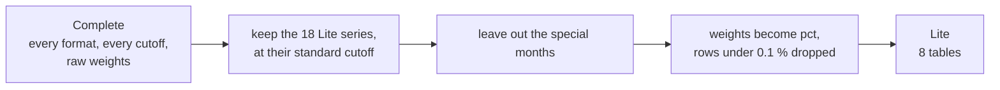

# Smogon Usage Stats

ETL pipeline that turns the Pokemon Showdown usage stats archive
([smogon.com/stats](https://www.smogon.com/stats/), since November 2014) into normalized Kaggle datasets:

- **Lite**: the most played formats, standard rating cutoff only, CSV + Parquet.
- **Complete**: every format, every cutoff, every section, in Parquet. One dataset per year.

Both are public on Kaggle:

- Lite: [smogon-usage-stats-lite](https://www.kaggle.com/datasets/martinlepadan/smogon-usage-stats-lite)
- Complete: `smogon-usage-stats-complete-<year>`, from [2014](https://www.kaggle.com/datasets/martinlepadan/smogon-usage-stats-complete-2014) to [2026](https://www.kaggle.com/datasets/martinlepadan/smogon-usage-stats-complete-2026)
- Python package: [smogon-stats](https://pypi.org/project/smogon-stats/) on PyPI, source in [`packages/smogon-stats`](packages/smogon-stats)
- Notebooks: [Lite, getting started](https://www.kaggle.com/code/martinlepadan/smogon-usage-stats-lite-getting-started) and [Complete, how to](https://www.kaggle.com/code/martinlepadan/smogon-usage-stats-complete-how-to), sources in [`notebooks/`](notebooks)

> Status: the datasets, the package and the notebooks are published. A monthly GitHub Actions run adds each new month.

## Use the data

```bash
pip install smogon-stats
```

```python
import smogon_stats as ss

lite_usage = ss.load_lite("usage", formats=["gen9ou"])
usage = ss.load("usage", years=[2019, 2020], formats=["gen8ou"], cutoffs=[1825])
moves = ss.load("moves", months=["2024-08"])
```

`load_lite` reads the Lite dataset, `load` the Complete ones, across as many years as asked.
Both return polars LazyFrames and download only the files the query needs. No Kaggle account is required.
In a Kaggle notebook, attach the datasets you read to the notebook first.
The tables and their columns are described on the Kaggle pages.

## Setup

Requires [uv](https://docs.astral.sh/uv/).

```bash
uv sync                      # venv + dev dependencies
uv sync --group notebook     # adds Jupyter and matplotlib for the notebooks
uv run pre-commit install    # git hooks (ruff, mypy, basic checks)
cp .env.example .env         # Kaggle credentials, only needed to publish
```

## Commands

```bash
uv run smogon-dataset --help        # pipeline CLI
uv run smogon-dataset inventory     # 1. list every file of the archive
uv run smogon-dataset sync          # 2. download and parse the months not done yet
uv run smogon-dataset pokemon       # 3. build the pokemon table, check every name against it
uv run smogon-dataset formats       # 4. build the formats table
uv run smogon-dataset normalize     # 5. write the Complete tables, validated on the way out
uv run smogon-dataset lite          # 6. derive the Lite dataset from the Complete tables
uv run smogon-dataset stage         # 7. lay the Complete tables out for Kaggle, one dataset per year
uv run pytest -m "not network"      # tests that don't hit smogon.com
uv run pytest --cov                 # with coverage
uv run ruff check --fix && uv run ruff format
uv run mypy
```

## Data flow

Each arrow is one command, run in this order.



`inventory` lists every file on the server, and `sync` works from that list: it downloads one month, parses it, then deletes the download.
The archive is 54 GB gzipped, so the disk never holds more than one raw month.
The folders of `data/kaggle` are what is uploaded to Kaggle. Each month, `smogon-dataset update --publish` does it for the new month alone, from a GitHub Actions run.

Steps 3 and 4 build the two lookup tables that the later steps read.



The interim tables are a lossless copy of what Smogon wrote: `sync` rebuilds every chaos JSON from them and refuses the month if it differs.
Meaning is only added in `normalize`: names become `pokemon_id`, the weights are split into one table per kind (moves, items, spreads...).
A month that breaks a validation rule is not written.

### How the tables join



`format` is the name Smogon used that month (`ou` in 2015, `gen6ou` later). `formats` gives it a `format_id`, a `family` and a generation so a tier can be followed across the years.
`teammates` and `checks_counters` point to a second Pokémon, through `teammate_id` and `opponent_id`.

### From Complete to Lite



The 18 series are the OU of each generation, 8 tiers that follow the current generation, and the most played VGC format of each month.
Special months (`2020-11-H1`, `2023-09-DLC1`...) are slices of a month that is also published whole, so keeping them would count battles twice.
The Lite keeps `cutoffs`, `usage`, `abilities`, `items`, `moves`, `tera_types`, plus `pokemon` and `formats`.

### What is on disk

```
data/
  raw/
    2026-09/                 # directory listings stay, stat files go once the month is parsed
    showdown/pokedex.json
  interim/
    inventory.parquet        # one row per file of the archive
    pokemon.parquet
    formats.parquet
    2026-09/                 # chaos_info, chaos_pokemon, chaos_weights, chaos_checks,
                             # usage, leads, metagame, metagame_stalliness, ...
  complete/
    2026-09/                 # usage.parquet, moves.parquet, teammates.parquet, ...
  lite/
    usage.parquet            # one file per table, all months
    usage.csv
  kaggle/
    complete-2026/           # one Kaggle dataset per year
      usage/2026-09.parquet  # hard link to data/complete/2026-09/usage.parquet
      pokemon.parquet
      formats.parquet        # the months of that year
      files.parquet          # which table exists for which month
      dataset-metadata.json
    lite/
```

A new version of a Kaggle dataset has to send every file again.
Cut by year, only the current year (2 to 4 GB) is uploaded each month, and the past years are left alone.

## Architecture

```
src/smogon_dataset/
  config.py        # source URL, rate limiting, paths
  cli.py           # `smogon-dataset` entry point
  fetch.py         # polite HTTP client with an on-disk cache
  listing.py       # reads the server's directory pages
  inventory.py     # crawl of the archive listings: one row per file
  parsers/         # raw file -> canonical tables, same shape for every era
  sync.py          # download + parse one month, then drop its raw files
  pokedex.py       # `pokemon` table from the Pokémon Showdown pokedex
  formats.py       # `formats` table: generation, family, Lite series
  normalize.py     # canonical tables -> tables of the Complete dataset
  validate.py      # pandera schemas and rules every Complete table must pass
  lite.py          # Complete tables -> Lite dataset (Parquet + CSV)
  publish.py       # Kaggle layout, one dataset per year for the Complete
  cards.py         # text and column descriptions of the Kaggle pages
packages/
  smogon-stats/    # the reader published on PyPI
scripts/           # one-off tools (fixture download, Kaggle covers)
tests/
  fixtures/<month> # real sample files from each era, laid out like the server
data/              # not versioned, layout in "Data flow"
notebooks/         # sources of the two Kaggle notebooks
.github/workflows/ # CI + monthly update
```

## Source and attribution

Usage stats are published by [Smogon](https://www.smogon.com/stats/) and computed from
[Pokémon Showdown](https://pokemonshowdown.com/) battles. Pokémon data (types, base stats) comes from
[smogon/pokemon-showdown](https://github.com/smogon/pokemon-showdown).

## License

The code, `smogon-stats` included, is under the [MIT license](LICENSE). The datasets are published under CC BY 4.0.
